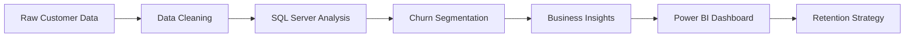

# E-Commerce Customer Churn Analysis

<p align="center">
  
</p>

<p align="center">
  
  
  
  
</p>

<p align="center">
  <b>SQL Server + Power BI | Business Intelligence | Retention Analytics</b>
</p>

<p align="center">
  Turning customer behavior data into actionable retention strategies and executive-ready insights.
</p>

---

## Overview

This project analyzes customer churn in an e-commerce business using SQL Server for data preparation and analysis, and Power BI for an executive dashboard and business storytelling.

The goal is to identify:

- customers most likely to churn
- product categories with the highest churn risk
- the impact of complaints on churn
- churn patterns across customer segments
- key retention opportunities for the business

---

## Business Problem

Customer churn is one of the biggest threats to e-commerce growth and profitability. When customers leave, businesses face:

- lower revenue and lifetime value
- higher acquisition costs
- reduced loyalty and trust
- weaker customer retention performance

This project helps answer: who is churning, why they are churning, and where retention efforts should be prioritized.

---

## Project Objectives

1. Clean and structure the raw customer dataset
2. Measure overall churn rate
3. Analyze churn by product category
4. Evaluate the effect of complaints on churn
5. Compare churn across marital status groups
6. Investigate satisfaction score behavior
7. Build a Power BI executive dashboard
8. Deliver business recommendations for retention strategy

---

## Solution Flow



---

## Technologies Used

| Tool | Purpose |
|---|---|
| SQL Server | Data cleaning, transformation, and analytical queries |
| SSMS | SQL development and testing |
| Power BI | Dashboarding and business intelligence |
| DAX | Performance metrics and calculations |
| Power Query | Data shaping and transformation |
| GitHub | Project documentation and portfolio sharing |

---

## Repository Structure

```text
E-Commerce-Customer-Churn-Analysis/
├── README.md
├── Dashboard.png
├── Ecommerce_Churn_Analysis.sql
├── E-Commerce Customer Churn Dashboard.pbix
└── dataset/
```

### File Descriptions

- `Ecommerce_Churn_Analysis.sql`  
  Contains the SQL workflow for data cleaning, customer segmentation, churn calculations, and exploratory analysis.

- `E-Commerce Customer Churn Dashboard.pbix`  
  Power BI file with interactive visuals and KPI tracking.

- `Dashboard.png`  
  Preview image of the final dashboard.

---

## Key Findings

### 1. Complaint status strongly affects churn
Customers with complaints show a noticeably higher churn rate compared with customers without complaints.

### 2. Product category matters
The analysis highlights that specific categories, especially Mobile Phone, show elevated churn risk.

### 3. Marital status segment is relevant
Certain customer groups, such as single customers, show stronger churn tendency and represent valuable retention opportunities.

### 4. Satisfaction alone does not explain churn
Some customers with relatively high satisfaction still churn, suggesting that other drivers such as pricing, service quality, and competition may be involved.

---

## Dashboard Highlights

The final dashboard includes:

- total customers and churned customers
- overall churn rate
- product category churn comparison
- complaint vs non-complaint churn analysis
- marital status segmentation
- satisfaction score analysis
- executive insight cards and recommendations

---

## Dashboard Preview

<p align="center">
  
</p>

---

## Executive Insights

### Insight 1: Complaints are a churn warning sign
Complaint handling should be treated as a retention priority. Fast response and recovery actions can reduce churn risk.

### Insight 2: Mobile Phone is a high-risk category
This category should be reviewed from a product support, delivery, and post-sale experience perspective.

### Insight 3: Retention campaigns should target high-risk segments
Customer groups showing elevated churn should receive personalized campaigns, loyalty offers, and proactive engagement.

### Insight 4: Satisfaction should be analyzed with additional factors
The relationship between satisfaction and churn is not linear; business teams should consider expectations, service quality, and competitor offers.

---

## Example SQL Logic

```sql
SELECT 
    COUNT(*) AS TotalCustomers,
    SUM(CAST(Churn AS INT)) AS TotalChurned,
    ROUND(
        CAST(SUM(CAST(Churn AS INT)) AS FLOAT) / COUNT(*) * 100,
        2
    ) AS ChurnRatePct
FROM ecommerce_churn_clean;
```

```sql
SELECT 
    ChurnStatus,
    ROUND(AVG(Tenure), 1) AS AvgTenureMonths,
    ROUND(AVG(CashbackAmount), 2) AS AvgCashback,
    ROUND(AVG(WarehouseToHome), 1) AS AvgWarehouseDistance
FROM ecommerce_churn_clean
GROUP BY ChurnStatus;
```

---

## Skills Demonstrated

### SQL
- Data cleaning
- T-SQL queries
- conditional logic
- aggregation and grouping
- churn analysis
- exploratory data analysis

### Power BI
- KPI design
- business dashboard development
- data visualization
- executive reporting
- decision-focused storytelling

### Business Intelligence
- customer segmentation
- churn analysis
- retention strategy
- insight generation
- action-oriented recommendations

---

## Recommended Next Steps

This project can be extended with:

- customer lifetime value analysis
- revenue at risk metrics
- churn prediction model
- RFM segmentation
- cohort analysis
- retention alert automation

---

## Final Recommendation

The strongest retention strategy is to focus on customers with complaints and high-risk product segments first, while building a continuous monitoring system in Power BI to detect churn trends early.

---

## Author

Abdel-Alim

Data Analyst • SQL Developer • Power BI Analyst • Business Intelligence Enthusiast

[GitHub Profile](https://github.com/Abdel-Alim)

---

<p align="center">
  <b>E-Commerce Customer Churn Analysis</b>
  <br>
  SQL Server • Power BI • Business Intelligence
</p>
