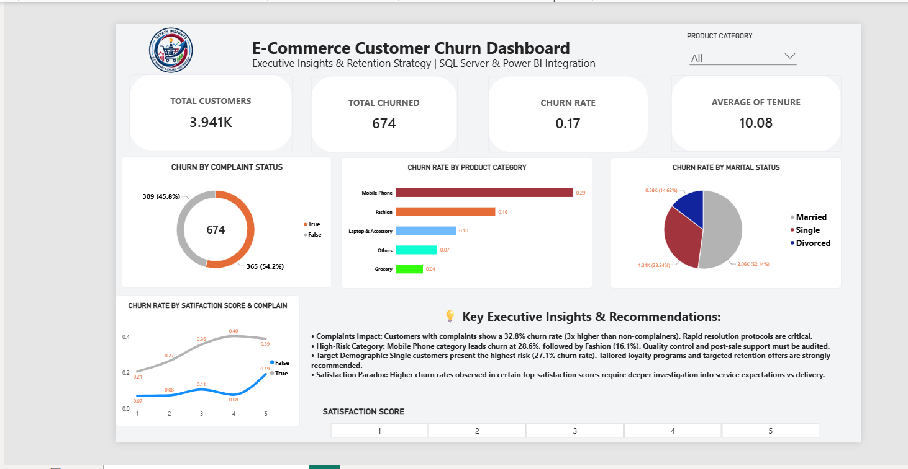

# E-Commerce Customer Churn Analysis

<p align="center">
  
</p>

<p align="center">
  
  
  
  
</p>

<p align="center">
  <b>SQL Server + Power BI | Customer Retention Analytics | Executive Dashboard</b>
</p>

<p align="center">
  <i>Turning customer behavior data into actionable retention strategies and data-driven business decisions.</i>
</p>

---

## Overview

This project analyzes customer churn in an e-commerce business using SQL Server for data preparation and advanced analysis, and Power BI for an executive dashboard and business storytelling.

The main goal is to identify:

- customers most likely to churn
- product categories with the highest churn risk
- the impact of complaints on churn
- churn patterns by customer segment
- the strongest retention opportunities for business growth

---

## Why this project matters

Customer churn directly threatens revenue, customer lifetime value, and profitability. Businesses lose not only sales, but also trust, retention efficiency, and growth potential.

This project helps answer three critical questions:

1. Who is likely to churn?
2. Why are they leaving?
3. Where should retention efforts be focused first?

---

## Business problem

E-commerce companies face rising pressure to retain customers in competitive markets. Churn often results from a combination of:

- product dissatisfaction
- poor customer support experience
- weak post-purchase engagement
- category-specific risk factors
- satisfaction gaps not visible without analysis

This dashboard helps business teams convert raw customer signals into practical retention actions.

---

## Objectives

- Clean and standardize customer data
- Measure overall churn rate
- Analyze churn by product category
- Assess the effect of complaints on churn
- Compare churn across customer groups
- Understand satisfaction score behavior
- Build an executive-ready Power BI dashboard
- Recommend retention strategies backed by evidence

---

## Solution flow


---

## Dashboard highlights

The final dashboard includes:

- total customers and churned customers
- overall churn rate
- product category churn comparison
- complaint vs non-complaint analysis
- marital status segmentation
- satisfaction score overview
- executive KPI cards and recommendations

<p align="center">
  
</p>

---

## Key insights

### 1. Complaints are a strong churn signal
Customers with complaints show a significantly higher churn rate than customers without complaints.

### 2. Some product categories are riskier than others
The analysis highlights categories such as Mobile Phone as especially vulnerable to churn.

### 3. Customer segment matters
Certain groups, including single customers, show stronger churn tendencies and represent priority opportunities for engagement.

### 4. Satisfaction alone does not explain churn
Some satisfied customers still churn, indicating that other factors such as service quality, pricing pressures, delivery experience, and competitive alternatives also influence retention.

---

## Example SQL logic

```sql
SELECT 
    COUNT(*) AS TotalCustomers,
    SUM(CAST(Churn AS INT)) AS TotalChurned,
    ROUND(
        CAST(SUM(CAST(Churn AS INT)) AS FLOAT) / COUNT(*) * 100,
        2
    ) AS ChurnRatePct
FROM ecommerce_churn_clean;
```

```sql
SELECT 
    ChurnStatus,
    ROUND(AVG(Tenure), 1) AS AvgTenureMonths,
    ROUND(AVG(CashbackAmount), 2) AS AvgCashback,
    ROUND(AVG(WarehouseToHome), 1) AS AvgWarehouseDistance
FROM ecommerce_churn_clean
GROUP BY ChurnStatus;
```

---

## Tech stack

| Tool | Purpose |
|---|---|
| SQL Server | Data cleaning, transformation, and churn analysis |
| SSMS | Query development and validation |
| Power BI | Dashboarding and executive storytelling |
| DAX | KPI logic and performance measures |
| Power Query | Data shaping and preparation |
| GitHub | Portfolio and project documentation |

---

## Repository structure

```text
E-Commerce-Customer-Churn-Analysis/
├── README.md
├── Dashboard.png
├── Ecommerce_Churn_Analysis.sql
├── E-Commerce Customer Churn Dashboard.pbix
└── dataset/
```

### File descriptions

- `Ecommerce_Churn_Analysis.sql`  
  Contains the SQL workflow for data cleaning, churn calculation, segmentation, and exploratory analysis.

- `E-Commerce Customer Churn Dashboard.pbix`  
  Power BI report with interactive visuals and executive KPIs.

- `Dashboard.png`  
  Preview of the final dashboard for quick presentation and portfolio use.

---

## Recommended next steps

This project can be extended with:

- customer lifetime value analysis
- revenue-at-risk calculations
- churn prediction model
- RFM segmentation
- cohort analysis
- retention alert automation

---

## Final recommendation

The most effective retention strategy is to prioritize customers with complaints and high-risk product categories, while building a continuous Power BI monitoring system to identify churn trends early.

---

## Author

Abdel-Alim

Data Analyst • SQL Developer • Power BI Analyst • Business Intelligence Enthusiast

[GitHub Profile](https://github.com/Abdel-Alim)

---

<p align="center">
  <b>E-Commerce Customer Churn Analysis</b>
  <br>
  SQL Server • Power BI • Business Intelligence
</p>
